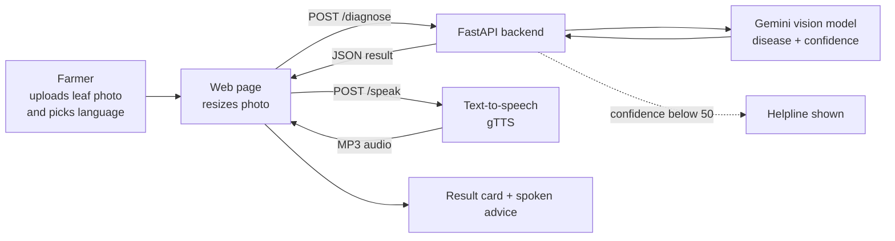
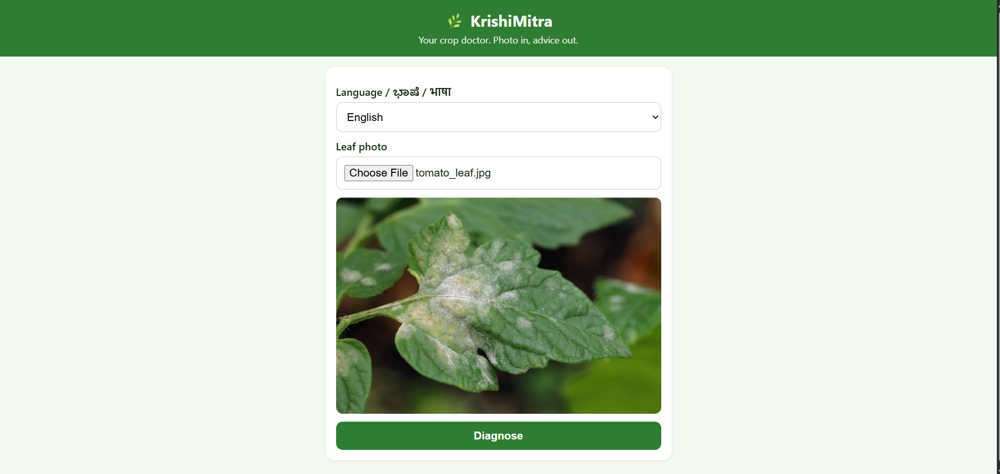
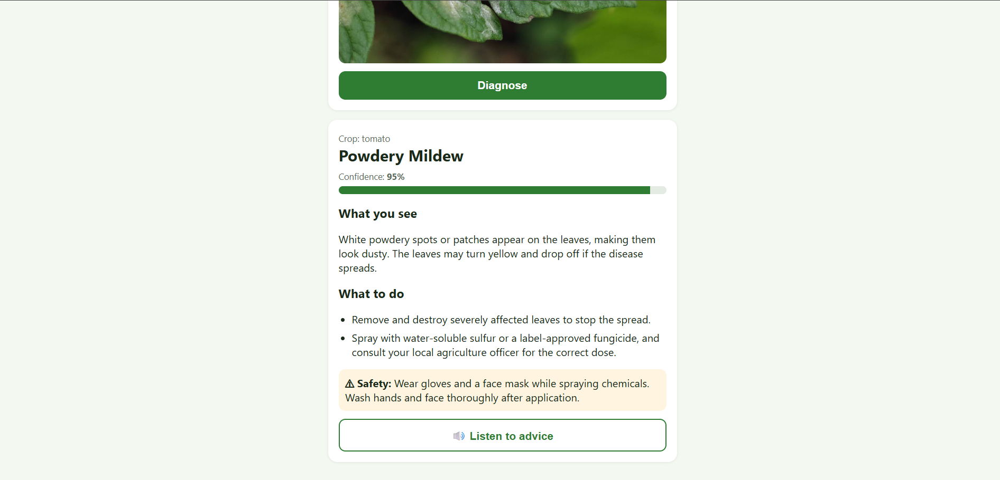

# 🌿 KrishiMitra: AI Crop Doctor for Farmers

**Photo of a sick leaf in. Diagnosis and spoken advice out, in English, Hindi or Kannada.**

> Built for the **Resurrect** hackathon (Round 1: Idea Pitch, Open Innovation theme).
> Status: **working prototype**. See [What is built today](#-what-is-built-today) and [Roadmap](#-roadmap-where-this-is-going).

**Demo video:** [https://youtu.be/NBKBavWeYqc ]

---

## 📌 Table of contents
1. [The problem](#-the-problem)
2. [Our solution](#-our-solution)
3. [What is built today](#-what-is-built-today)
4. [How it works](#-how-it-works)
5. [Tech stack](#-tech-stack)
6. [Screenshots](#-screenshots)
7. [Run it locally](#-run-it-locally)
8. [API reference](#-api-reference)
9. [Project structure](#-project-structure)
10. [Testing](#-testing)
11. [Safety and limitations](#-safety-and-limitations)
12. [Roadmap](#-roadmap-where-this-is-going)
13. [Plan for the 24-hour finale](#-plan-for-the-24-hour-finale)
14. [Team](#-team)

---

## 🚜 The problem

Small and marginal farmers often cannot identify crop diseases in time.

- FAO estimates that pests and plant diseases destroy **up to 40% of food crops globally every year**.
- Expert help (agriculture officers, Krishi Vigyan Kendras) is far away or hard to reach.
- Most farming apps are **English-only and text-heavy**, which excludes many farmers.
- The usual workaround is guessing, asking neighbours, or buying whatever pesticide a shop recommends. This costs money and can harm the crop and the soil.

**Who it is for:** small and marginal farmers in Karnataka and across India, especially those who are more comfortable speaking their local language than reading or typing English.

---

## 💡 Our solution

**KrishiMitra** ("farmer's friend") is an AI crop doctor that speaks the farmer's language.

1. The farmer uploads or captures a **leaf photo** and picks a **language**.
2. A vision AI model identifies the **crop and likely disease** with a **confidence score**.
3. The app explains the problem in **simple words**, with **treatment steps** and a **safety warning**.
4. The advice is **read aloud**, so no reading is needed.
5. If the AI is not sure, the app **shows a helpline** instead of guessing.

**What makes it different**
- Spoken advice in regional languages (Kannada, Hindi, English).
- Safety first: no invented pesticide doses, spraying warnings, and advice to confirm with a local agriculture officer.
- Honest confidence handling instead of always giving an answer.
- Automatic fallback across several AI models when one is busy.

---

## ✅ What is built today

This is a **working end-to-end prototype**.

| Feature | Status |
|---|---|
| Leaf photo upload or camera capture (mobile friendly) | ✅ Done |
| Language choice: English, Hindi, Kannada | ✅ Done |
| AI diagnosis: crop, disease, confidence, symptoms | ✅ Done |
| Treatment steps and safety warning | ✅ Done |
| Spoken advice in the chosen language (cloud text-to-speech) | ✅ Done |
| Low-confidence fallback with a helpline number | ✅ Done |
| Photo resized in the browser before upload | ✅ Done |
| Automatic fallback across several AI models | ✅ Done |
| Browser voice fallback if server audio fails | ✅ Done |
| Public GitHub repository, setup guide, `.env.example` | ✅ Done |

Not built yet: voice questions, weather advice, more crops, offline mode, online deployment. These are in the [roadmap](#-roadmap-where-this-is-going).

---

## ⚙️ How it works



- Photos are processed in memory and **not stored**.
- If one AI model is busy, the backend automatically tries the next one.
- If server audio fails, the page falls back to the browser's own voice.

---

## 🧰 Tech stack

| Layer | Technology |
|---|---|
| Backend | Python, FastAPI, Uvicorn |
| AI (vision and language) | Google Gemini API (`google-genai`), with model fallback |
| Voice output | gTTS (Kannada, Hindi, English) |
| Frontend | Single-page HTML, CSS, JavaScript (mobile friendly) |
| Config | `python-dotenv` (`.env` file, never committed) |
| Code hosting | GitHub |

---

## 🖼️ Screenshots





---

## 🚀 Run it locally

**Requirements:** Python 3.9 or newer, and a free Gemini API key from https://aistudio.google.com/apikey

```bash
git clone https://github.com/AnanyaK-arch12/krishimitra.git
cd krishimitra
python -m venv venv
```

Activate the virtual environment:

```bash
# Windows (PowerShell)
venv\Scripts\activate
# Mac / Linux
source venv/bin/activate
```

Install the packages:

```bash
pip install -r requirements.txt
```

Create a file named `.env` in the project folder (copy `.env.example`) containing:

```
GEMINI_API_KEY=your_key_here
```

Start the app:

```bash
uvicorn backend.main:app --reload
```

Open **http://127.0.0.1:8000/app/** in Chrome, choose a language, upload a leaf photo and click **Diagnose**.
Interactive API docs are at **http://127.0.0.1:8000/docs**.

**Troubleshooting**
- `PowerShell: running scripts is disabled`: run `Set-ExecutionPolicy -Scope CurrentUser RemoteSigned` once.
- `404 model not found`: model names change. Run `python list_models.py` to see the models your key can use, then update the `MODELS` list in `backend/main.py`.
- `503 high demand`: the free AI tier is busy. The app retries other models automatically. Wait a minute and try again.
- Never commit your `.env` file. It is listed in `.gitignore`.

---

## 🔌 API reference

| Method | Endpoint | Input | Output |
|---|---|---|---|
| GET | `/` | none | health message |
| POST | `/diagnose` | form-data: `image` (file), `lang` (English, Hindi or Kannada) | JSON: `crop`, `disease`, `confidence`, `symptoms`, `treatment[]`, `safety`, `model_used`, optional `fallback` |
| POST | `/speak` | form-data: `text`, `lang` | `audio/mpeg` (MP3) |
| GET | `/app/` | none | the web page |

Example result:

```json
{
  "crop": "Tomato",
  "disease": "Powdery Mildew",
  "confidence": 92,
  "symptoms": "White, powdery spots on the upper surface of the leaf...",
  "treatment": ["Remove severely infected leaves", "Improve air flow", "..."],
  "safety": "Wear a mask and gloves while spraying...",
  "model_used": "gemini-3.5-flash"
}
```

---

## 📁 Project structure

```
krishimitra/
├── backend/
│   └── main.py          # FastAPI app: /diagnose, /speak, serves the web page
├── frontend/
│   └── index.html       # Single-page UI: upload, language, result, audio
├── sample_images/       # Leaf photos used for testing
├── screenshots/         # Images used in this README
├── list_models.py       # Utility: lists Gemini models available to your key
├── requirements.txt
├── .env.example         # Template for your API key
└── README.md
```

---

## 🧪 Testing

The prototype has been tested with sample tomato leaf photos, for example a tomato leaf correctly identified as **powdery mildew** with high confidence. A larger accuracy test on more tomato and paddy photos is planned and will be reported here.

---

## ⚠️ Safety and limitations

- KrishiMitra gives **suggestions, not a certified diagnosis**. Serious cases should be confirmed with a local agriculture officer or Krishi Vigyan Kendra.
- The app does **not** invent pesticide doses. It suggests label-approved options and adds safety warnings.
- Accuracy depends on photo quality. Many diseases look alike, and field photos are noisier than dataset images.
- Currently focused on **tomato and paddy**.
- Needs an internet connection. It currently runs locally and is not deployed online.
- Uses free-tier AI and voice services, which have rate limits and can be busy.
- gTTS uses an unofficial Google Translate voice route, so it is suitable for a prototype but should be replaced with an official text-to-speech service in production.

---

## 🗺️ Roadmap: where this is going

**Phase 1: Prototype (done)**
Photo diagnosis, three languages, spoken advice, safety handling, GitHub release.

**Phase 2: Stronger and easier to use**
- Voice questions: the farmer speaks, the app answers
- More crops and diseases (chilli, groundnut, ragi, maize, and more)
- Weather-aware advice, such as "rain tomorrow, delay spraying"
- Follow-up reminders to re-check the plant after a few days
- "Was this helpful?" feedback to find mistakes

**Phase 3: A real product**
- Deployment online and as an installable app (PWA), tested on low-end phones
- Offline and low-data mode for weak rural networks
- Expert-reviewed knowledge base for treatment advice
- Nearby agri-input shops, Krishi Vigyan Kendra contacts and government scheme information
- Diagnosis history for each field
- Access through WhatsApp or a phone call (IVR) for farmers without smartphones

**Phase 4: Scale and sustainability**
- Pilot with farmers, farmer groups (FPOs) or a Krishi Vigyan Kendra
- Partnerships with government agencies, NGOs or agri-input companies
- Official text-to-speech and a higher-limit AI plan for reliability
- Privacy controls for photos and location

---

If we may continue KrishiMitra, we will prioritise voice questions, online deployment, phone testing and an accuracy test on more photos.

---

## 👥 Team

**Team name:** [your team name]

| Name | Role |
|---|---|
| [Ananya K] | Backend and AI |
| [Gayathri ] | Frontend and voice |
| [Chaithra S Uchil] | Testing, demo and pitch |

---

*Made with care for farmers. Always confirm serious crop problems with a local agriculture expert.*